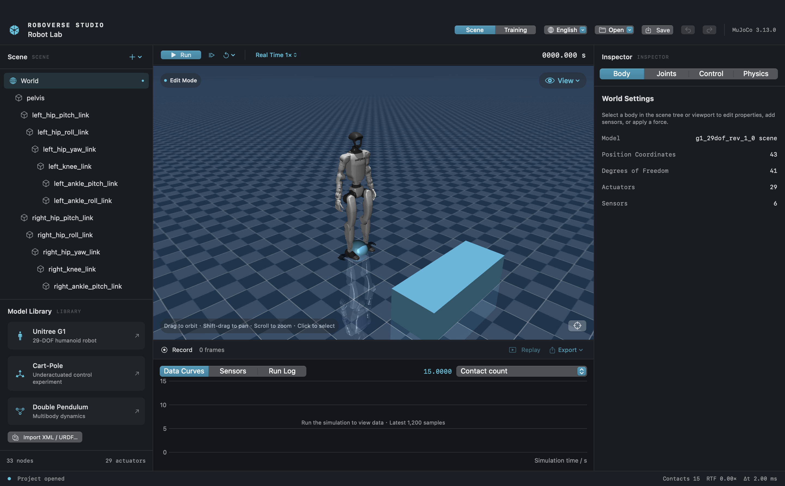
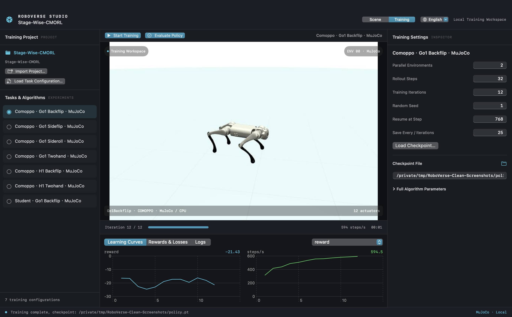
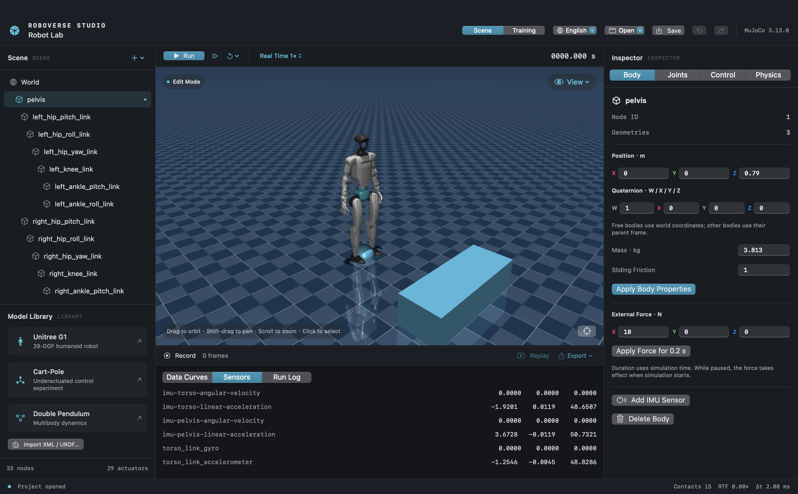

# RoboVerse Studio

A native macOS workbench for robot simulation and reinforcement learning, built with SwiftUI and MuJoCo.

[Download](https://github.com/sinpoce/RoboVerse-Studio/releases/latest) · [中文](README.zh-CN.md) · [Training guide](docs/CUSTOM_TRAINING.md)



## Features

- Import MJCF/XML and supported URDF models; edit robot scenes, body properties, joints, and actuators.
- Run, pause, and step simulations; inspect contacts, IMU sensors, and live signal plots.
- Save portable projects, record and replay experiments, and export CSV data.
- Configure training tasks, view learning curves, save and resume checkpoints, and evaluate policies.
- English and Simplified Chinese interfaces. English is the default.

Includes Unitree G1, cart-pole, and acrobot models. The training workspace supports task/algorithm plugins and a [Stage-Wise-CMORL](https://github.com/rllab-snu/Stage-Wise-CMORL) adapter for Go1/H1 tasks. Imported projects and their assets are downloaded separately.





## Install

**Apple Silicon · macOS 14 or later**

Download the ZIP from [Releases](https://github.com/sinpoce/RoboVerse-Studio/releases/latest), extract it, and move **RoboVerse Studio.app** to Applications. Python, MuJoCo, and PyTorch are bundled.

The app is ad hoc signed and is not notarized by Apple. If macOS blocks the first launch, use **System Settings → Privacy & Security → Open Anyway**. A SHA-256 checksum accompanies the download.

## Use

Choose a model from the library or import your own. Drag to orbit, Shift-drag to pan, and scroll to zoom. Use **Joints** and **Control** to configure the robot; use **Record** and **Replay** to capture an experiment. Save the scene as a `.mjstudio` project.

Switch to **Training** to import a compatible task configuration or project. See the [training guide](docs/CUSTOM_TRAINING.md) for supported adapters and configuration. Pretrained policies are not included.

## Build

Requires Swift 5.9+ and Python 3.11 on macOS.

```bash
git clone https://github.com/sinpoce/RoboVerse-Studio.git
cd RoboVerse-Studio
PYTHON=python3.11 make setup
make run
```

`make app` builds a standalone application in `dist/`. Packaging requires a relocatable CPython installation, such as uv-managed Python.

## License

[Apache-2.0](LICENSE). Models and dependencies retain their upstream licenses; see [third-party notices](THIRD_PARTY_NOTICES.md).

Built with [MuJoCo](https://github.com/google-deepmind/mujoco), [mjbatch](https://github.com/kevinzakka/mjbatch), and [PyTorch](https://github.com/pytorch/pytorch). The G1 model comes from [MuJoCo Menagerie](https://github.com/google-deepmind/mujoco_menagerie/tree/main/unitree_g1).
